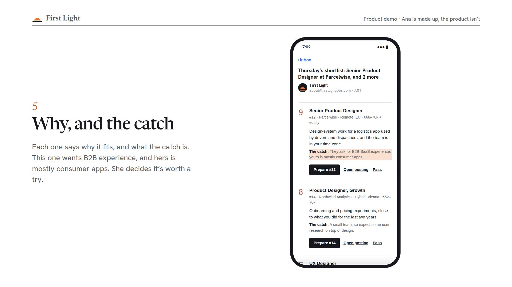

<picture>
  <source media="(prefers-color-scheme: dark)" srcset="assets/header-dark.png">
  
</picture>

Before breakfast, First Light reads thousands of new job postings from company career pages and remote job boards. You get the few that fit you, each with why it fits and what the catch is. Like one, and it drafts the cover letter and the answers for the application form. You check them and apply yourself.

The product demo, 109 seconds: the signup, the morning email, an application pack and an interview prep, with Ana, a made-up tester. Or the [46-second version](https://firstlightjobs.com/media/First-Light-promo.mp4).

### How it works

1. **Fill in one form.** Upload your CV and say what jobs you want, where you can work and the lowest salary you'd take. About ten minutes.
2. **Read the morning shortlist.** At most five roles, by email or Telegram, each with a score, why it fits and the catch.
3. **Get the application drafted.** Tap Prepare. A few minutes later you have the CV to send, a cover letter and answers to the usual form questions.
4. **Get ready for the interview.** Forward the invitation. About ten minutes later you have a prep: who you're meeting, what they'll look for, your own stories with their numbers, and a one-page cheat sheet for the call.

### What it never does

- Apply to jobs for you
- Message recruiters, or anyone else
- Log in to your LinkedIn or scrape it
- Sell your data

It can't promise you a job either. It finds openings that fit and helps you apply well. Who gets hired is between you and the employer.

### Where it stands

It isn't open to everyone yet. A small pilot is running now, for office jobs in Europe: remote, or in your city.

**Want to hear when it opens?** [Leave your email](https://firstlightjobs.com/waitlist/?from=github) &nbsp;·&nbsp; **Got a code?** [Join here](https://firstlightjobs.com/join/) &nbsp;·&nbsp; [firstlightjobs.com](https://firstlightjobs.com)

First Light · Vienna, Austria
